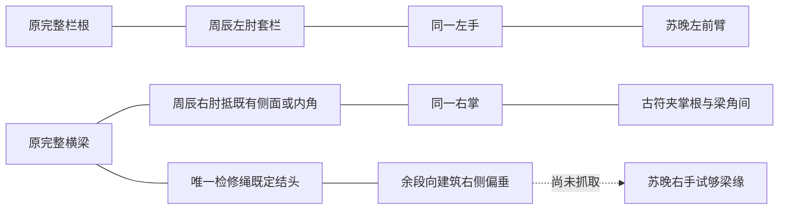

# 第三集救援｜左右握点与阻挡设计 V27

2026-10-19。制作内部设计，供下一张全身接触图和真实试片使用。不是影视场景图、不是角色定妆替换、不计作已采用素材；以下关系不是实际3D距离、关节可达、载荷或动态证明。正式人物衣貌、原完整梁/栏根和既有单绳均沿用。

V29纠正：原剧本只要求“右肘抵梁”，没有指定“梁顶”。此前本设计及失败生图提示额外加了梁顶承托限制，应撤销。重力持续指向建筑右侧，下一张须交代右肘抵同一完整梁的侧向受力面/内角，能与左臂套栏共同阻止向右滑移；不能靠把普通向下承托姿态旋转画面来替代。历史实际生成提示词不改写，四候选仍保留失败记录。该修正不取消右肘接触、古符阻握或左手救人的原目标。

| 对象 | 本阶段必须做什么 | 不允许替代 |
|---|---|---|
| A周辰左上臂/左肘 | 从原完整栏根一侧绕过，栏根位于左肘弯内，形成清楚的套栏接触 | 只把袖子放在栏根前方；新造柱子；右臂代套 |
| A左前臂/左手 | 沿同一条可追踪的左臂伸向B，左手抓B的左前臂、位置在腕上 | 握B右手/衣领/脖子；持符与救人并到同一手；新增手掌 |
| A右上臂/右肘 | 右肘直接抵原完整横梁的既有侧向受力面/内角，接触处可见，并与向右重力的受力方向一致 | 误限只向下承托的梁顶；高举手臂撑上方墙；衣袖遮掉全部支点；在肘下新造梁 |
| A右前臂/右掌 | 从右肘连续到右掌，原小暗铜古符处于掌根与同梁角之间，阻止完整包握 | 符悬在空中或只是捏在指尖；符回腰；左右手互换 |
| B苏晚左臂 | 左前臂由A左手握住，手腕、肘、肩连接可追踪 | 让B另一臂被抓而仍标左臂 |
| B右臂/右肩 | 右手试够梁缘、尚未抓检修绳；右肩一处浅擦伤和对应窄衣裂/少量血痕 | 错到左肩；衣装整体重设计；右手提前握绳或腰环卸力 |
| B双脚 | 顺右向受力寻找原侧缝，03-03/04尚未稳定双脚支撑 | 普通向下垂直吊挂；早期踝伤/鞋；提前蹬稳 |
| 原检修绳 | 仅一条，固定端绕原完整梁，余段向建筑右侧偏垂、在B右手可及附近 | 重复上下两条；从高空新锚垂下；改系裂栏或绑身体 |
| 旧铁剑 | 全程在唯一完整木鞘内，沿A背带贴背 | 拔剑/飞剑救人；第二鞘；后集断剑提前 |

## 下一张图的执行顺序

1. 先在同侧35mm中景或适度高机位核清原梁侧向受力面/内角、原栏根、A两肩/两肘和B左前臂的三维相对位置；建筑竖柱保持原方向，不滚转画面假装右向重力。先核受力方向再定构图，不强迫套用四候选的普通向下吊挂姿态。
2. 先使两个肘部接触清楚，再检查两条手臂是否连续，确认A左抓B左前臂、A右掌独持符。不得因为服饰漂亮或局部握点正确就接受其他错误。
3. 确定B右肩解剖侧别再加浅伤/对应衣裂。人物正面时右肩在观察者左侧；转体后必须沿肩—肘—腕追踪，不能凭画面左右猜侧别。
4. 只保留原梁一条检修绳；03-03/04不抓绳、不腰环承重。03-04主动放符后才做下一张空右掌握梁状态；03-05先双脚蹬缝、再右手取原绳。
5. 以四项已留档候选逐项反查。只通过局部则继续修正，不改变完整全身目标，不以近景或关系图代替正式素材。实际承力/握距、滑落/抓取与肩伤连续性仍待真实视频验证。

## 当前实际状态

4张实际941×1672候选均未采用，0张全身救援正式图；3项全身任务仍待补制。现有V26三张局部/尾态参考继续仅按其有限时点使用，全季采用数量不因本文件增加。

内部SVG转PNG导出命令被自动审批拒绝，工具只返回“blocked by policy”，未给出具体理由；该命令未执行、没有对应SVG/PNG或渲染成功声明。本文件保留文字和Mermaid关系示意，不绕过拒绝导出图片。下一张正式图仍使用内置image_gen。

[实际任务](第三集全身救援接触任务V27.json) · [四候选真实输入/提示词/QA](第三集全身救援接触候选生成归档V27.json) · [唯一交接](../../文档/项目总控与交接.md)
