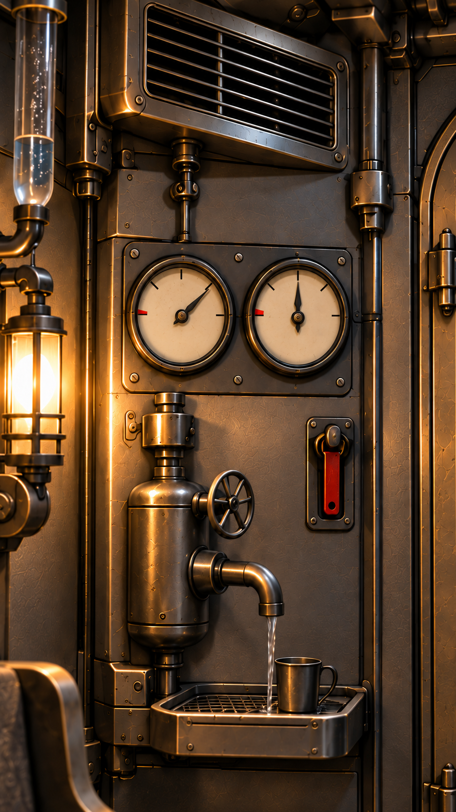

# 避难舱水气余量与拉铃

当前采用，2026-10-19。内置image_gen；原生941×1672，未放大，不称原生2K/4K。人物服饰母图不改。初图局部未准确对齐刻度，修正后仅保留当前采用图。

适用范围：第十一集03读双表：按设备正面左水三格/右气两格，半圆上弧四区间；红区在低余量端。只器具读数与可及关系，不能推算固定小时，水流/风声按当前段，不因图中持续水线让所有段开阀。



## 实际初始提示词

```text
Use case: precise-object-edit. Asset type: episode11 shelter water-air meter detail for no verbal time promises, native maximum fine detail, vertical9:16.
Edit supplied refuge interior into a close clear cinematographic insert of the EXISTING pair of analog meters on the LEFT wall, their original mount/pipes and original adjacent red pull-bell. Keep identity, spacing left and right, graphite machined wall with restrained bronze, warm low lamp at left. No people, no text, no numerical labels.
Each meter has the same EXACT four equal usable intervals with five boundary ticks across a 180-degree semicircle: zero lower-left, full lower-right, midpoint top. On LEFT water dial one needle points upper RIGHT to the 3/4 boundary (THREE of four intervals). On RIGHT air dial one needle points straight UP at the midpoint (TWO of four intervals). Distinct clear dark needles, no second pointer. A small RED low-reserve sector only beside the LOWER LEFT zero endpoint on BOTH dials, not full end. Existing pull-bell red strap below/right between meters and door remains reachable in the same arrangement; do not pull it or light alarm. Original vent above still present at edge, original water valve/tray/cup beneath partly visible to establish which is water. No new electronic display, percent, extra gauge, diagram arrows, written Chinese or English. Fine complete well-maintained ancient interstellar craft, low saturation, not rust/rubble/fantasy gold palace. Crisp 50mm medium-depth detail; shows levels only, cannot imply tested fixed hours.
```

## 实际局部修正提示词

```text
Precise local edit of ONLY the printed scales on the TWO EXISTING ROUND gauge faces. Preserve their original round housings, EXACT LEFT needle direction upper-right 1:30, EXACT RIGHT needle straight up12:00, the red pull-bell, water valve/cup, original wall/pipes/vent and scene crop. On BOTH cream dial faces use ONLY FIVE black boundary tick marks across the UPPER semicircle: leftmost9:00 zero, upper-left10:30 quarter, top12:00 half, upper-right1:30 three-quarter, rightmost3:00 full. No tick marks on LOWER half. Put one small RED low-reserve sector on the UPPER semicircle immediately next to LEFTMOST9:00 endpoint, between9:00 and9:20. Erase existing lower-left red sector and every lower-half tick; no red at full/right. No words or numbers or labels. Left pointer tip aligns three-quarter upper-right tick, right pointer aligns half top tick, exactly one pointed needle on each. Keep entire original scene and photoreal precise low-saturation craft untouched.
```

