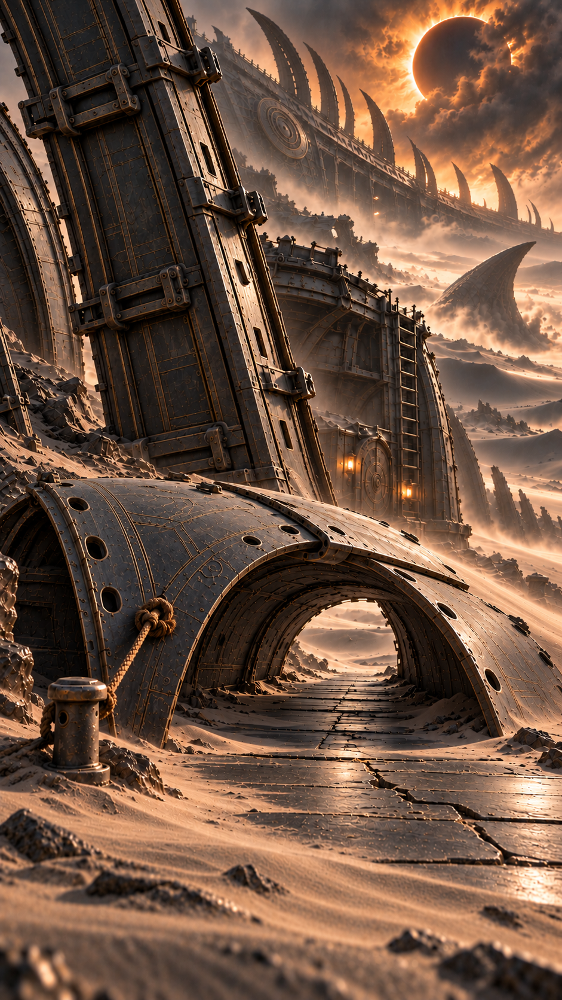

# 短低拱当前结构

当前采用，2026-10-19。使用内置 image_gen；原生941×1672，9:16近似比例，未放大，不称原生2K/4K。人物定妆与服饰母图未修改。

适用边界：两片原弯板/一个短拱，约1.5—2米短通道；仅第10集06末/07/08未毁阶段的环境结构，不包含实际角色、净空测量或动作。



## 生成提示词

```text
Use case: precise-object-edit. Asset: ONE empty photoreal cinematic environment reference of the FINISHED two-panel LOW crawl shelter for episode10, portrait 9:16 at highest genuine native detail. Reference1 is the edit target for LOCATION, fixed heavy rib, single short rope and original ground peg, distant ship/eclipsed sun; reference2 supplies the nearby intact heavy rib and ship-panel craftsmanship. Correct the target's repeated long tunnel: this temporary shelter is made of exactly TWO portable curved graphite thin hull panels meeting and interlocking their existing long curled edges into ONE short low barrel arch, not a permanent masonry corridor. Camera low 35mm at original near entrance with outside side angle enough to count BOTH panel pieces and their ONE visible joining seam on top. Only one cross-section, only one open far exit about 1.5 to 2 metres from near entrance; NO receding sequence of ribs, no repeated ceiling arches, no hidden third panel, no extended tunnel. Arch opening knee-to-waist low, only crouch/crawl height; use the same preexisting waist-high bollard peg in near lower-left for scale, arch crest a little lower than peg top. Same one useful short brown rope secures only the near OUTER panel corner through existing hole to the original peg at lower-left, ONE taut span, both knot contacts readable, no second rope, no cord across crawling path. The other support is the visible fixed thick ship rib, not new anchors. Ground beneath only original graphite stone path and silver-black sand, clear crawl passage. Hull panels dark graphite with fine quiet bronze embedded line, a few existing fastener holes, hand-crafted precise seams, gently aged but not broken down; remove random rubbish, orange rust, universal chips. Same distant monumental vessel silhouette and partially veiled eclipse for scale, subdued gray/bronze and small warm light, no neon or huge orange wash. NO people, energy box, force-field, beast or weapon. Do not show failed high panel or destroyed arch in this state. Full arch intact, passage clear, short. Real lens/material, film still not videogame render, no labels/dimensions/arrows/characters/text/logo/watermark. This is an assembled-state reference, not a step-by-step diagram or proof of load/dynamics.
```

