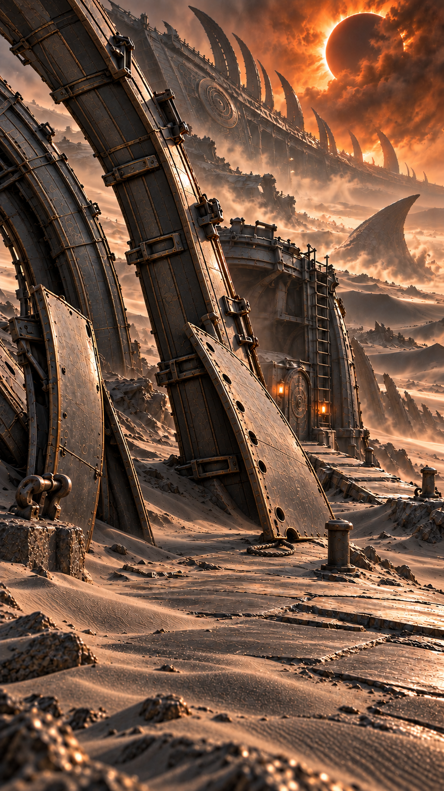

# 第一高板失稳后的布局

当前采用，2026-10-19。使用内置 image_gen；原生941×1672，9:16近似比例，未放大，不称原生2K/4K。人物定妆与服饰母图未修改。

适用边界：仅第10集03翻回后/04/05备料前的空环境：第一板斜靠固定肋，第二片仍另靠原肋；图中无人物受伤接触，不能用于失败前或已成拱。



## 生成提示词

```text
Use case: precise-object-edit. Asset type: episode 10 live-action cinema environment reference, vertical 9:16 native highest available detail, no enlargement.
Edit the supplied near-rib ship scene into the moment AFTER the FIRST PORTABLE PANEL was blown inward. Keep the SAME massive fixed thick ship rib, same distant eclipse and ship, original peg, walkway and manual door/ladder. Foreground exactly ONE smaller portable curved graphite-bronze shell panel has tipped over inward: bottom edge planted on original walkway, upper edge caught against the existing fixed rib at a shallow unstable angle. Show clean complete identifiable curved edges, existing punched attachment hole and one loose SHORT rope beside it, NOT a new giant ship hull. Original tall fixed ribs remain upright. A second portable curved panel remains separately leaning against the same rib, not connected or moved yet. No completed arch, no tunnel, no extra panels beyond these two portable pieces. No people, injury, weapons, creature, box or magical glow. Windblown silver-black sand sweeps sideways, no rubble pile. Intact refined ancient interstellar metal, charcoal with restrained bronze edge light, controlled eclipse amber not neon. Photoreal cinematic composition makes failed leaning panel and actual solid catch point legible, 35mm. No text/logos/watermark. Image is environmental arrangement only, not a character action frame.
```

