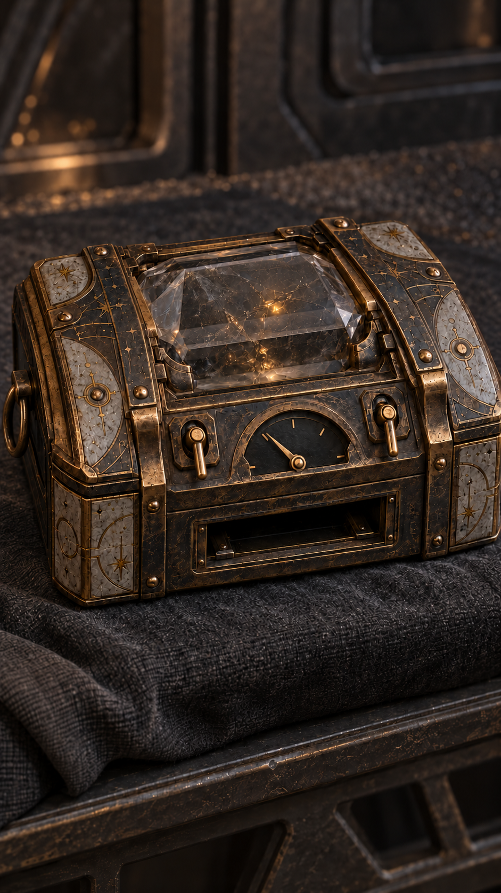

# 晶匣双杆关一格余量

当前采用，2026-10-19。使用内置 image_gen；原生941×1672，9:16近似比例，未放大，不称原生2K/4K。人物定妆与服饰母图未修改。

适用边界：第10集11约7秒后/12及第11集首帧双杆关闭的一格残量细节；承托布不代表故事位置，实际在避难舱工作台；不提前用于护膜仍开阶段。



## 生成提示词

```text
Use case: precise-object-edit. Asset type: cinematic prop state reference for episode10-11 tail and episode11 beginning, vertical 9:16 native maximum detail.
Edit ONLY the two lever positions and gauge needle / core glow of the supplied crystal box. Preserve exact same SINGLE case, camera, cloth support, five boundary ticks/four equal gauge intervals, bottom DARK rectangular navigation slot, intricate quiet bronze/graphite surface, shape and size. LEFT lever must now be DOWN/OFF identical mechanical downward orientation to the existing RIGHT DOWN/OFF lever. Both handles clearly hang down from the upper pivot; no raised left handle. Semicircular meter: zero at lower left, half at top, full lower right; needle now points to the UPPER LEFT quarter boundary, exactly ONE OF FOUR intervals remaining, not zero and not three quarters. Only one needle. Existing central crystal stays present but its light much dimmer, faint residual amber glimmer, no shield projection, no blue flame, no navigation output. Hands absent, no people, no new switches, no writing/labels/numbers, no overlay, no logos/watermark. Preserve real material precision, low saturation. This is a state-detail still, background cloth does not establish story location.
```

