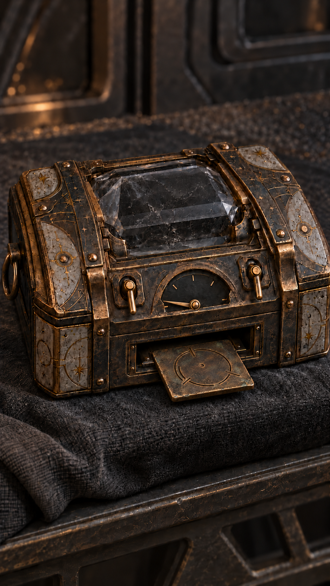

# 晶匣耗尽与单片压出

当前采用，2026-10-19。内置image_gen；原生941×1672，未放大，不称原生2K/4K。人物服饰母图不改。初图局部未准确对齐刻度，修正后仅保留当前采用图。

适用范围：第十一集02输出后约7—10秒、A取片前：双杆垂下、指针零位、芯无主动发光，唯一薄铜片仍部分在原槽；取走之后不能继续让槽含片。不用于10集或11-01一格阶段。



## 实际初始提示词

```text
Use case: precise-object-edit. Asset type: episode11-02 final coordinate output cinematic prop insert, 9:16 native highest detail, no enlargement.
Input1 is the exact crystal box to preserve. Input2 supplies ONLY the shape of the SMALL THIN copper coordinate tile on the LEFT, not the ice fragment. Keep same single box, shape, bronze/graphite intricate surfaces, two levers DOWN/OFF, same five-boundary semicircle gauge and same framing on dark cloth. Change gauge needle from quarter to ZERO at far LOWER LEFT boundary, not upper left. Central crystal fully dark colorless/gray residual reflections only, NO active golden core or glow. From the existing single bottom rectangular slot, one THIN COPPER TILE slides PARTWAY OUT horizontally toward camera. Use input2 tile square round-cornered shape and etched open circle/three breaks/central small dot, only 1-2mm thick, scaled narrow enough to actually fit the slot, width less than slot opening. Face tilted visible with no text. Box is exhausted, cannot output a second tile. Do NOT place a loose second coordinate tile, do NOT include ice piece, hands/people/energy magic or extra needles, no labels/logos/watermark. Emphasize clear slot-to-tile mechanical contact, controlled cinematic soft light, same original item not a redesigned chest. This is prop detail only, actual story box remains on refuge worktable.
```

## 实际局部修正提示词

```text
Precisely correct ONLY the gauge needle of this generated box. Preserve every other pixel/composition/object including BOTH levers DOWN, DARK core, exactly one copper tile half out of original slot and its etchings. Needle must move to the ZERO endpoint of the semicircular scale, the LEFTMOST lowest small boundary tick at the BASE of the arch. The needle tip must touch that leftmost zero tick, approximately directly LEFT of pivot (slightly upward following tilted perspective). Currently needle points above that tick into residual interval; rotate tip DOWN about 15 degrees toward the leftmost lowest tick, until no usable interval remains below it. Do not add a new needle or change any ticks. Zero energy. No text, no extra output, no ice.
```

